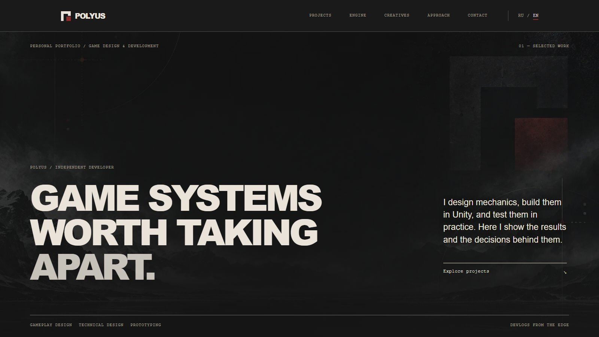

# POLYUS — Game Design Portfolio

**[polyus.dev](https://polyus.dev)** · personal portfolio of an independent game designer and Unity developer.

Gameplay design · Technical design · Prototyping

## On the site
- **Projects** — case studies of shipped and in-progress games (How High, 4×4, Blood Rave): role, design decisions, current state.
- **Engine** — Enterprise Engine, a Unity foundation for building games faster: architecture and status.
- **Creatives** — ad creatives and their production.
- **Approach** — how I design, build and test mechanics.

## Tech
Static site on GitHub Pages — HTML, CSS and vanilla JavaScript, no build step. Content lives in JSON files (`content.json`, `projects.json`, `creatives.json`, `enterprise.json`, `design.json`) and is edited through [Pages CMS](https://pagescms.org/). Russian and English versions (`?lang=en`).

Editing notes: [docs/CMS.md](docs/CMS.md).
